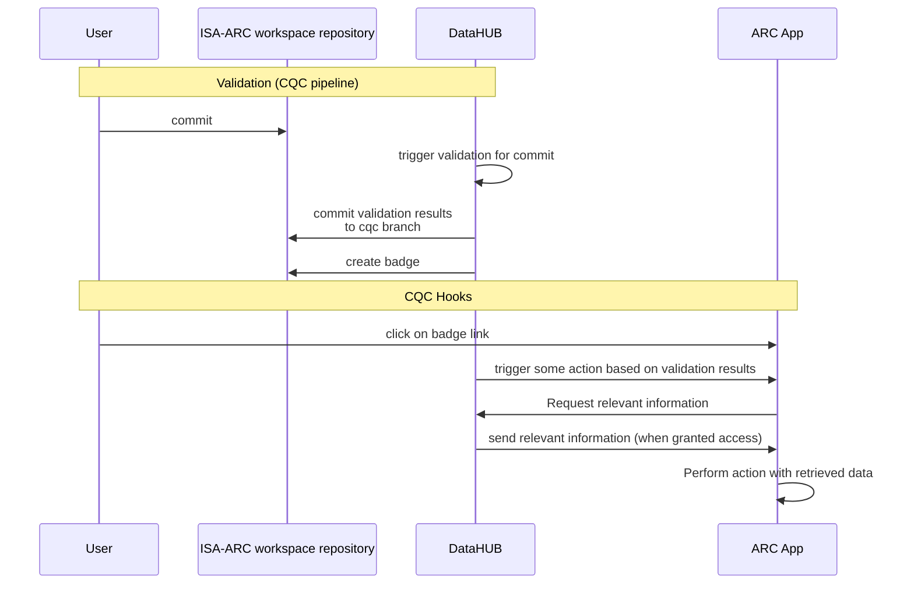

# ISA-ARC Workspace specification, version 3.0.0-draft.2

**Status:** Draft.

**Persistent identifier:** <https://w3id.org/arc/workspace/isa-arc>

Please provide feedback via GitHub issues or a pull request.

**GitHub repository:**  <https://github.com/nfdi4plants/ISA-ARC-Workspace>

Copyright 2022–2025 [DataPLANT](https://nfdi4plants.de).

Licensed under the Creative Commons License CC BY, Version 4.0; you may not use this file except in compliance with the License. You may obtain a copy of the License at https://creativecommons.org/about/cclicenses/. This license allows re-users to distribute, remix, adapt, and build upon the material in any medium or format, so long as attribution is given to the creator. The license allows for commercial use. Credit must be given to the creator.

# Table of Contents

- [Introduction](#introduction)
  - [Extensions](#extensions)
- [ISA-ARC Workspace Structure and Content](#arc-structure-and-content)
  - [High-Level Schema](#high-level-schema)
  - [Example ISA-ARC workspace structure](#example-arc-structure)
  - [ISA-ARC Workspace Representation](#arc-representation)
  - [ISA-XLSX Format](#isa-xlsx-format)
  - [WR-XLSX Format](#wr-xlsx-format)
  - [Study and Resources](#study-and-resources)
  - [Assay Data and Metadata](#assay-data-and-metadata)
  - [Workflow Description](#workflow-description)
  - [Run Description](#run-description)
  - [Additional Payload](#additional-payload)
  - [Top-level Metadata and Workflow Description](#top-level-metadata-and-workflow-description)
    - [Investigation and Study Metadata](#investigation-and-study-metadata)
  - [Data Path Annotation](#data-path-annotation)
    - [Examples](#examples)
      - [General Pattern](#general-pattern)
      - [Folder Specific pattern](#folder-specific-pattern)
  - [Licensing](#licensing)
- [Shareable and Publishable ISA-ARC Workspaces](#shareable-and-publishable-arcs)
- [Reproducible ISA-ARC Workspaces](#reproducible-arcs)
- [Quality Control for ISA-ARC Workspaces](#mechanisms-for-arc-quality-control)
  - [Validation](#validation)
    - [Validation cases](#validation-cases)
    - [Validation packages](#validation-packages)
    - [Reference implementation](#reference-implementation)
  - [Continuous quality control](#continuous-quality-control)
    - [The cqc branch](#the-cqc-branch)
    - [The validation\_packages.yml file](#the-validation_packagesyml-file)
    - [ARC Apps](#arc-apps)
    - [Reference implementation](#reference-implementation-1)
- [Best Practices](#best-practices)
  - [Community Specific Data Formats](#community-specific-data-formats)
  - [Compression and Encryption](#compression-and-encryption)
  - [Directory and File Naming Conventions](#directory-and-file-naming-conventions)
- [Appendix: Mapping ISA-ARC Workspaces to RO-Crate](#appendix-conversion-of-arcs-to-ro-crates)

# Introduction

This document specifies ISA-ARC, DataPLANT's domain-specific application of the Annotated Research Context (ARC) for workspaces supporting ARC research data management (ARC RDM). It defines workspace conventions for organizing research data, metadata, and computational provenance using ISA-XLSX, WR-XLSX, and CWL. Requirements in this document apply to ISA-ARC workspaces. Throughout this document, *workspace* refers to an ISA-ARC workspace.

ISA-ARC workspaces are designed to support research data management in accordance with the [FAIR principles](https://doi.org/10.1038/sdata.2016.18).

An ISA-ARC workspace is intended to capture research data, analysis and metadata and their evolution in scenarios ranging from single experimental setups to complex experimental designs in plant biological research. Its design intent is to assist researchers in meeting FAIR requirements, and also minimize the workload for doing so. ISA-ARC workspaces are self-contained and include study materials, assay and measurement data, workflow, and computation outputs, accompanied by metadata and history, in one package. Toward this, ISA-ARC workspaces combine existing standards, leveraging the properties of the [ISA metadata model](https://isa-specs.readthedocs.io/en/latest/isamodel.html), for administrative and experimental metadata and the [Common Workflow Language (CWL)](https://www.commonwl.org) to represent processing specifications.

ISA-ARC workspaces are furthermore designed to enable straightforward conversion to other types of research data archives, such as e.g. [Research Object Crates](https://www.researchobject.org/ro-crate/), to facilitate straightforward operation with widely used data repositories (e.g. PRIDE, GEO, ENA). Therefore, ISA-ARC workspaces aggregate administrative, experimental, and workflow metadata within a common structure.

This specification is intended as a practical guide for software authors to create tools for generating and consuming ISA-ARC workspaces.

The key words MUST, MUST NOT, REQUIRED, SHALL, SHALL NOT, SHOULD, SHOULD NOT, RECOMMENDED, MAY, and OPTIONAL in this document are to be interpreted as described in [RFC 2119](https://datatracker.ietf.org/doc/html/rfc2119).  This specification is based on the [ISA model](https://isa-specs.readthedocs.io/en/latest/isamodel.html) and the [Common Workflow Specification (v1.2)](https://www.commonwl.org/v1.2/).

## Extensions

The ISA-ARC Workspace specification can be extended and will evolve over time through community discussion and pull requests in this repository.

Backwards compatible changes, e.g. the addition of new optional metadata fields, will be implemented in _minor version increases_.
All changes that are not backwards compatible with the current ISA-ARC Workspace specification will be implemented in _major version increases_.
By this, we try to adopt [semantic versioning](https://semver.org/).

<a id="arc-structure-and-content"></a>

# ISA-ARC Workspace Structure and Content

ISA-ARC workspaces are based on a strict separation of data and metadata content into study material (*studies*), measurement and assay outcomes (*assays*), computation results (*runs*) and computational workflows (*workflows*) generating the latter. The scope or granularity of an ISA-ARC workspace aligns with the necessities of individual projects or large experimental setups.

## High-Level Schema

Each ISA-ARC workspace is a directory containing the following elements:

- *Studies* are collections of material and resources used within the investigation. Study-level metadata is stored in [ISA-XLSX](#isa-xlsx-format) format in a `isa.study.xlsx` file, which MUST exist to specify the input material or data resources. Resources MAY include biological materials (e.g. plant samples, analytical standards) created during the current investigation. Resources MAY further include external data (e.g., knowledge files, results files) that need to be included and cannot be referenced due to external limitations. Resources described in a study file can be the input for one or multiple assays. Further details on `isa.study.xlsx` are specified [below](#study-and-resources). Resource (descriptor) files MUST be placed in a `resources` subdirectory. Further explications about data entities defined in the study are stored in [ISA-XLSX](#isa-xlsx-format) format in a `isa.datamap.xlsx` file in the **study folder**. Further details on this are specified [in the isa-xlsx specification](ISA-XLSX.md#datamap-file).

- *Assays* correspond to outcomes of experimental assays or analytical measurements (in the interpretation of the ISA model) and are treated as immutable data. Each assay is a collection of files, together with a corresponding metadata file, stored in a subdirectory of the top-level subdirectory `assays`. Assay-level metadata is stored in [ISA-XLSX](#isa-xlsx-format) format in a `isa.assay.xlsx` file, which MUST exist for each assay. Further details on `isa.assay.xlsx` are specified [below](#assay-data-and-metadata). Assay data files MUST be placed in a `dataset` subdirectory. Further explications about data entities defined in the assay are stored in [ISA-XLSX](#isa-xlsx-format) format in a `isa.datamap.xlsx` file in the **assay folder**. Further details on this are specified [in the isa-xlsx specification](ISA-XLSX.md#datamap-file).

- *Workflows* represent data analysis routines (in the sense of CWL tools and workflows) and are a collection of files, together with a corresponding CWL description, stored in a single directory under the top-level `workflows` subdirectory. A per-workflow executable CWL description is stored in `workflow.cwl`, which MUST exist for all workspace workflows. Further details on workflow descriptions are given [below](#workflow-description).

- *Runs* capture data products (i.e., outputs of computational analyses) derived from assays, other runs, or study materials using workflows (located in the aforementioned *workflows* subdirectory). Each run is a collection of files, stored in the top-level `runs` subdirectory. It MUST be accompanied by a per-run CWL workflow description, stored in `run.cwl` as further described [below](#run-description).

- *Top-level metadata and workflow description* tie together the elements of an ISA-ARC workspace in the contexts of investigation and associated studies (in the ISA definition), captured in the file `isa.investigation.xlsx` in [ISA-XLSX format](#isa-xlsx-format), which MUST be present.

All other files contained in an ISA-ARC workspace (e.g., a `README.txt`, pre-print PDFs, additional annotation files) are referred to as *additional payload*, and MAY be located anywhere within the workspace structure. However, an ISA-ARC workspace MUST be [reproducible](#reproducible-arcs) and [publishable](#shareable-and-publishable-arcs) even if these files are deleted. Further considerations on additional payload are described [below](#additional-payload).

Note:

- Subdirectories and other files in the top-level `studies`, `assays`, `workflows`, and `runs` directories are viewed as additional payload unless they are accompanied by the corresponding mandatory description (`isa.study.xlsx`, `isa.assay.xlsx`, `workflow.cwl`, `run.cwl`) specified below. This is intended to allow gradual migration from existing data storage schemes to the workspace schema. For example, *data files* for an assay may be stored in a subdirectory of `assays/`, but are only identified as an assay of the workspace if metadata is present and complete, including a reference from top-level metadata.

<a id="example-arc-structure"></a>

## Example ISA-ARC workspace structure

```
<top-level directory> 
|   isa.investigation.xlsx         
\--- studies
    \--- <study_name> 
            |    isa.study.xlsx  
            |    isa.datamap.xlsx [optional]
            \--- resources 
            \--- protocols [optional / add. payload]
\--- assays
    \--- <assay_name> 
            |    isa.assay.xlsx  
            |    isa.datamap.xlsx [optional]
            \--- dataset 
            \--- protocols [optional / add. payload]
\--- workflows  
    \--- <workflow_name> 
            |    workflow.cwl 
            |    docker-compose.yml [optional / add. payload]
            |    isa.workflow.xlsx [optional]   
            |    isa.datamap.xlsx [optional]
\--- runs   
    \--- <run_name> 
            |    [files;...] (different output files) 
            |    run.cwl
            |    run.yml  
            |    isa.run.xlsx [optional]   
            |    isa.datamap.xlsx [optional]   
```

<a id="arc-representation"></a>

## ISA-ARC Workspace Representation

ISA-ARC workspaces are Git repositories, as defined and supported by the [Git C implementation](https://git-scm.org) (version 2.26 or newer) with [Git-LFS extension](https://git-lfs.github.com) (version 2.12.0), or fully compatible implementations.

Workspace terminology implicitly borrows from Git and Git-LFS terminology. For example, an ISA-ARC workspace commit is simply a Git commit, and the workspace history is the repository history. Furthermore, an ISA-ARC workspace can contain multiple branches, etc.

Tree objects (resp. directories) and blobs (i.e., files) of all branch heads in the repository MUST adhere to the [workspace schema](#arc-structure-and-content). ISA-ARC workspaces allow all typical Git operations (e.g. clone, branch).

All representation suitable for Git-LFS repositories are also valid representations of ISA-ARC workspaces. This includes both bare repositories (without a checked out working copy) and non-bare repositories (i.e. a `.git` directory with one or more attached working copies). In particular, it is possible and intended to maintain ISA-ARC workspaces on local user filesystems and via Git repository hosting services. No requirements are made for state and contents of working copies.

Notes:

- Archival representation (e.g. `.zip` or `.tar.gz`) are valid workspace representations if archives are created to preserve file attributes, i.e. if unarchiving preserves Git interoperability. Furthermore, Git's [bundle mechanism](https://git-scm.com/docs/git-bundle) can be used to create archives of complete ISA-ARC workspaces or individual branches. For archiving purposes, `git bundle create --all` or an equivalent should be used.

- Elements of an ISA-ARC workspace are implicitly content-addressable using standard Git mechanisms via SHA1 hashes.

- Removing the `.git` top-level subdirectory (and thereby all provenance information captured within the Git history) from a working copy makes the representation nonconformant with this workspace specification.

## ISA-XLSX Format

ISA-ARC Workspace, ISA-XLSX, and WR-XLSX are separate specification documents that can be referenced individually. This workspace specification, version 3.0.0-draft.2, references ISA-XLSX version 3.0.0-draft.1 for experimental metadata and shared XLSX conventions.

[ISA-XLSX format specification, version 3.0.0-draft.1](ISA-XLSX.md)

## WR-XLSX Format

This workspace specification references WR-XLSX version 1.0.0-draft.1 for workflow and run metadata. WR-XLSX extends ISA-XLSX version 3.0.0-draft.1 and reuses its shared conventions and sheet rules.

[WR-XLSX format specification, version 1.0.0-draft.1](WR-XLSX.md)

## Study and Resources

The characteristics of all material and resources used within the investigation must be specified in a study. Studies must be placed into a unique subdirectory of the top-level `studies` subdirectory. All ISA metadata specific to a single study MUST be annotated in the file `isa.study.xlsx` at the root of the study's subdirectory. This workbook MUST contain a single resources description that can be organized in one or multiple worksheets. 

The `study` file MUST follow the [ISA-XLSX study file specification](ISA-XLSX.md#study-file).

 Material or experimental samples can be stored in the form of virtual sample files (containing unique identifiers) in the resources directory. Each external data file can be interpreted as a virtual sample and stored accordingly under resources. External data refers to data that is neither originating within the investigation scope of the workspace nor can be referenced externally, but is required to ensure reproducibility.

Protocols that are necessary to describe the sample or material creating process can be placed under the protocols directory.

Further explications about data entities defined in the study MAY be stored in [ISA-XLSX](#isa-xlsx-format) format in a `isa.datamap.xlsx` file, which SHOULD exist for each study. Further details on `isa.datamap.xlsx` are specified [in the isa-xlsx specification](ISA-XLSX.md#datamap-file).

## Assay Data and Metadata

All measurement data sets are considered as assays and are considered immutable input data. Assay data MUST be placed into a unique subdirectory of the top-level `assays` subdirectory. All ISA metadata specific to a single assay MUST be annotated in the file `isa.assay.xlsx` at the root of the assay's subdirectory. This workbook MUST contain a single assay that can be organized in one or multiple worksheets. 

The `assay` file MUST follow the [ISA-XLSX assay file specification](ISA-XLSX.md#assay-file).

Further explications about data entities defined in the assay MAY be stored in [ISA-XLSX](#isa-xlsx-format) format in a `isa.datamap.xlsx` file, which SHOULD exist for each assay. Further details on `isa.datamap.xlsx` are specified [in the isa-xlsx specification](ISA-XLSX.md#datamap-file).

Notes:

- This ISA-ARC Workspace specification does not prescribe repository-specific assay metadata requirements. Conversion of ISA-ARC workspaces into other repository or archival formats (e.g. PRIDE, GEO, ENA) may however mandate the presence of specific terms required in the destination format.

- To ensure reusability of assays, it is strongly RECOMMENDED to include necessary metadata mandated by typical metadata schemes necessary for reproduction. This process is facilitated by the use of templates that can be found [here](https://github.com/nfdi4plants/SWATE_templates).

- It is RECOMMENDED to order worksheets according to the input-output-relation for readability.

- It is RECOMMENDED to adopt the structure outlined [below](#best-practices) to organize assay data files and other supporting information.

- An implementation that ensures assay annotation consistent with these requirements is provided by the [SWATE tool](https://github.com/nfdi4plants/Swate).

- While assays MAY in principle contain arbitrary data formats, it is highly RECOMMENDED to use community-supported, open formats (see [Best Practices](#best-practices)).

## Workflow Description

*Workflows* in ISA-ARC workspaces are computational steps that are used in computational analysis of an ISA-ARC workspace's assays and other data transformation to generate a [run result](#run-description). Typical examples include data cleaning and preprocessing, computational analysis, or visualization. Workflows are used and combined to generate [run results](#run-description), and allow reuse of processing steps across multiple [run results](#run-description).

Workflow execution and metadata MUST be described using the [Common Workflow Language](https://www.commonwl.org/) (CWL), [v1.2](https://www.commonwl.org/v1.2/) or higher, in a file `workflow.cwl`, which MUST be placed in the subdirectory containing all files specific to this workflow under the top-level `workflows` subdirectory. This file MUST contain either of:

- A CWL [tool description](https://www.commonwl.org/v1.2/CommandLineTool.html). Tool descriptions MUST be self-contained and not refer to any files outside the workspace root directory. All paths used within the tool description MUST be relative to itself.

- A CWL [workflow description](https://www.commonwl.org/v1.2/Workflow.html). Such descriptions MAY utilize other workspace workflows as [nested workflows](https://www.commonwl.org/user_guide/topics/workflows.html#nested-workflows), but MUST use relative paths in this case. Files outside the workspace root directory MUST NOT be referenced.

The file locations can be seen in the [Example ISA-ARC workspace structure](#example-arc-structure).

Prospective top level metadata about the workflow SHOULD be stored in [WR-XLSX](#wr-xlsx-format) in a `isa.workflow.xlsx` file, which SHOULD exist for each workflow. Further details on `isa.workflow.xlsx` are specified [in the WR-XLSX specification](WR-XLSX.md#workflow-file).

Further explications about data and metadata entities defined in the workflow MAY be stored in [ISA-XLSX](#isa-xlsx-format) format in a `isa.datamap.xlsx` file, which MAY exist for each workflow. Further details on `isa.datamap.xlsx` are specified [in the isa-xlsx specification](ISA-XLSX.md#datamap-file).

Notes:

- There are no requirements on the structure or granularity of workflows. An ISA-ARC workspace MAY contain no workflows at all if it contains no [run results](#run-description), or MAY utilize a single workflow to generate a single run result containing all computational output.

- While workflows typically are (and SHOULD be) *generic*, i.e. a single workflow can be applied to different data of the same type, this is not a requirement. It is allowed to hard-code assay file paths and other parameters if workflow reusability is not a priority.

- Tool descriptions SHOULD contain a reproducible execution environment description in the form of a [Docker](https://www.commonwl.org/user_guide/topics/using-containers.html) container description.

- It is expected that workflow and tool descriptions are authored semi-automatically, e.g. using the [Swate](https://nfdi4plants.github.io/nfdi4plants.knowledgebase/swate/) tool for annotation of the `isa.datamap.xlsx` file.

## Run Description

**Runs** in an ISA-ARC workspace represent all artifacts that result from some computation on the data within the workspace, i.e. [assays](#assay-data-and-metadata) and [external data](#study-and-resources). These results (e.g. plots, tables, data files, etc. ) MUST reside inside one or more subdirectory of the top-level `runs` directory.

Each such subdirectory MUST contain a workflow description `run.cwl`, given in [Common Workflow Language](https://www.commonwl.org/) (CWL), [v1.2](https://www.commonwl.org/v1.2/) or higher, that describes how the files contained with the run are derived from assay or external data, or other runs. `run.cwl` MUST be placed in the subdirectory under the top-level `runs` directory. A parameter file `run.yml` MAY be given to specify run-specific input parameters.

`run.cwl` MAY (and sensibly, should) refer to assay data files, external data files, workflow descriptions, and files in other run results; such references MUST use relative paths, which can be given in the corresponding `run.yml`. The paths MUST be relative to the location of the `run.yml` file. Furthermore, `run.cwl` MUST specify as outputs all result files. `run.cwl` MUST BE executable without referring to [additional payload files](#additional-payload) or files outside the workspace.

Retrospective top level metadata about the run and metadata about the provenance of the generated data of this run SHOULD be stored in [WR-XLSX](#wr-xlsx-format) in a `isa.run.xlsx` file, which SHOULD exist for each run. Further details on `isa.run.xlsx` are specified [in the WR-XLSX specification](WR-XLSX.md#run-file).

Further explications about data entities created by execution of the run MAY be stored in [ISA-XLSX](#isa-xlsx-format) format in a `isa.datamap.xlsx` file, which MAY exist for each run. Further details on `isa.datamap.xlsx` are specified [in the isa-xlsx specification](ISA-XLSX.md#datamap-file).

Notes:

- Run descriptions are intended to ensure that the computational analysis encapsulated within an ISA-ARC workspace can be fully reproduced.

- Any files produced by executing the run description which are not specified as CWL outputs in `run.cwl` are considered additional workspace payload. Furthermore, all files of all subdirectories under `run` that are not referenced from the top-level workflow are considered additional payload.

- It is expected that run descriptions are authored semi-automatically, e.g. using the [Swate](https://nfdi4plants.github.io/nfdi4plants.knowledgebase/swate/) tool for annotation of the `isa.datamap.xlsx` and the `isa.run.xlsx` file.

## Additional Payload

ISA-ARC workspaces can include additional payload according to user requirements, e.g. presentations, reading material, or manuscripts. While these files can be placed anywhere in the workspace, it is strongly advised to organize these in additional subdirectories.
Especially for the storage of protocols, it is RECOMMENDED to place protocols (assay SOPs) in text form with the corresponding assay in /assays/<assay_name>/protocol/<protocol_name>.

Note:

- All data missing proper annotation (e.g. studies, assays, workflows or runs) is considered additional payload independent of its location within the workspace.

## Top-level Metadata and Workflow Description

*Top-level metadata and workflow description* tie together the elements of an ISA-ARC workspace in the contexts of an investigation captured in the `isa.investigation.xlsx` file, which MUST be present.

The `investigation` file MUST follow the [ISA-XLSX investigation file specification](ISA-XLSX.md#investigation-file).

Furthermore, run-level reproducibility information SHOULD be provided in the CWL `run.cwl` ([Run Description](#run-description)).

### Investigation and Study Metadata

The workspace root directory is identifiable by the presence of the `isa.investigation.xlsx` file in XLSX format. It contains top-level information about the investigation and MUST link all assays and studies within an ISA-ARC workspace. Study and assay objects are registered and grouped with an investigation to record other metadata within the relevant contexts.
<!-- The study file is optional and can be used to group assays into studies within one investigation. 
Multiple studies MUST be stored using one worksheet per study in `isa.studies.xlsx` in the root directory of the workspace.
The study-level SHOULD define [ISA factors](https://isa-specs.readthedocs.io/en/latest/isamodel.html#study) of a study and MAY contain overlapping information also to be found in all assays grouped by the study. -->

## Data Path Annotation

All metadata references to files or directories in an ISA-ARC workspace MUST follow one of the `patterns` defined in this section, which MUST only be used if the `constraint` is met.

Files and directories referenced in workspace metadata files MUST follow one of the two following `constraints`:

- `Local constraint`: The directory or file MUST be placed somewhere inside the workspace.

  - The `general pattern`, which is applicable throughout the workspace and SHOULD be used to specify the path relative to the workspace root.

  - The `folder specific pattern`, which MAY be used only in specific metadata contexts:
    - Data nodes in `isa.assay.xlsx` files: The path MAY be specified relative to the `dataset` sub-folder of the assay.
    - Data nodes in `isa.study.xlsx` files: The path MAY be specified relative to the `resources` sub-folder of the study.

- `Public constraint`: The located resource MUST be publicly accessible and retrievable using a standardized communications protocol (see [FAIR A1.1](https://www.go-fair.org/fair-principles/a1-1-protocol-open-free-universally-implementable/)).

  - The `URL pattern`, which is applicable throughout the workspace and MUST be used to specify path locations anywhere on the web, given the following formatting constraints:
    - The string MUST follow the [URI Syntax Specification (rfc3986)](https://datatracker.ietf.org/doc/html/rfc3986#section-1.1.3).
    - The string MUST be a proper `URL`, i.e. it MUST contain all information necessary to locate the described resource.


### Examples

#### General Pattern

In this example, there are two `assays`, with `Assay1` containing a measurement of a `Source` material, producing an output `Data`. `Assay2` references this `Data` for producing a new `Data`.

Use of `general pattern` relative paths from the workspace root folder:

`assays/Assay1/isa.assay.xlsx`:

| Input [Source Name] | Component [Instrument model]          | Output [Data] | 
|-------------|---------------------------------|----------------------------------|
| input       | Bruker 500 Avance | assays/Assay1/dataset/measurement.txt |

`assays/Assay2/isa.assay.xlsx`:

| Input [Data] | Component [script file]          | Output [Data] |
|----------------------------------|---------------------------------|----------------------------------|
| assays/Assay1/dataset/measurement.txt | assays/Assay2/dataset/script.sh | assays/Assay2/dataset/result.txt |

#### Folder Specific Pattern

In this example, there are two `assays`, with `Assay1` containing a measurement of a `Source` material, producing an output `Data`. `Assay2` references this `Data` for producing a new `Data`.

Use of `folder specific pattern` relative paths from `Assay1` and `Assay2` `Dataset` folders, respectively:

`assays/Assay1/isa.assay.xlsx`:

| Input [Source Name] | Component [Instrument model]          | Output [Data] | 
|-------------|---------------------------------|----------------------------------|
| input       | Bruker 500 Avance | measurement.txt |

`assays/Assay2/isa.assay.xlsx`:

| Input [Data] | Component [script file]          | Output [Data] |
|----------------------------------|---------------------------------|----------------------------------|
| assays/Assay1/dataset/measurement.txt | script.sh | result.txt |

Note, that to reference `Data` which is part of `Assays1` in `Assay2`, the `general pattern` is necessary either way. Therefore it is considered the more broadly applicable and recommended pattern.

## Licensing

_Disclaimer: This is not legal advice, when in doubt consult a legal professional in your jurisdiction_

**ISA-ARC workspaces SHOULD be shared under a license of the authors’/owners’/creators’ choice that clearly states the data usage terms.**

Per default, digital artifacts such as the workspace fall under exclusive copyright of the creator(s).
In other words, the creator has the exclusive right to decide how the workspace is used, distributed, or modified.
To allow others to use, distribute, or modify the workspace, the creator(s) can choose a more permissive license. Examples of very permissive licenses include the [Creative Commons Attribution 4.0 International License](https://creativecommons.org/licenses/by/4.0/) and the [MIT License](https://opensource.org/licenses/MIT).

_Adding any license information to an ISA-ARC workspace already makes it more FAI**R**_, as it clarifies the conditions under which it may be (re)used by others.
However, **the choice of license is up to the creator(s) of the workspace**.
It may not be possible to share ISA-ARC workspaces without restrictions due to legal (e.g. patenting or IPR) or ethical constraints, for example when sensitive clinical data is involved.
Furthermore, the license of an ISA-ARC workspace can change during its lifetime: it may be shared under a more restrictive license during the research and/or review phase and under a more permissive license after publication.

**Choosing a license for ISA-ARC workspaces is optional.**
**When no license information is provided, all rights are reserved to the creators/owners.**
However, it is strongly encouraged to use licenses to increase the FAIRness of your workspace where possible.

If a license of choice shall apply to an ISA-ARC workspace, the license information MUST be included in the root of the workspace in a plaintext file named `LICENSE`.
Text file extensions `.txt` or `.md` are allowed.

<a id="shareable-and-publishable-arcs"></a>

# Shareable and Publishable ISA-ARC Workspaces

ISA-ARC workspaces can generally be shared in any state. Under this specification, a workspace intended for public archiving and DOI registration MUST be *publishable*. For the purposes of this specification, a workspace is considered *publishable* when it fulfills the following conditions:

- Investigation-level (administrative) metadata contains minimally the following terms:

  - Investigation Identifier
  - Investigation Title
  - Investigation Description
  - INVESTIGATION CONTACTS section and/or Comment[ORCID] of the PI(s)
    - Investigation Person Last Name
    - Investigation Person First Name
    - Investigation Person Email
    - Investigation Person Affiliation

- A *publishable* ISA-ARC workspace MUST NOT be *empty*: it MUST contain minimally a single assay or a single workflow.

- All [Data Path Annotations](#data-path-annotation) made in the workspace MUST resolve to an existing, accessible data resource.

- A *publishable* ISA-ARC workspace MUST be [reproducible](#reproducible-arcs)

Notes:

- The attribute *publishable* does not imply that data and metadata contained in an ISA-ARC workspace are suitable for publication in a specific outlet (e.g. PRIDE, GEO, EBI) nor that metadata is complete or enables reusability of data. While it may be straightforward to convert the workspace schema into one required by specific publishers or repositories, additional metadata requirements may be enforced during conversion. These are intentionally not captured in this specification.

- As noticed above experimental metadata necessary for publication in a specific outlet is encoded by templates that can be found [here](https://github.com/nfdi4plants/SWATE_templates).

- These administrative metadata support DOI registration; the registering service's requirements also apply.

<a id="reproducible-arcs"></a>

# Reproducible ISA-ARC Workspaces

Reproducibility of an ISA-ARC workspace refers mainly to its *runs*. Within a workspace, it MUST be possible to reproduce the *run* data. Therefore, necessary software MUST be available in *workflows*. In the case of non-deterministic software the run results should represent typical examples.

<a id="mechanisms-for-arc-quality-control"></a>

# Quality Control for ISA-ARC Workspaces

ISA-ARC workspaces support iterative research data management in DataPLANT.
The mechanisms in this section report the current state and quality of these workspaces.

## Validation

The process of assessing quality parameters of an ISA-ARC workspace is further referred to as _validation_ of the workspace against a [_validation package_](#validation-packages), where the _validation package_ is an arbitrary set of [validation cases](#validation-cases) that the workspace MUST pass to qualify as _valid_ in regard to the _validation package_.

### Validation cases

A **validation case** is the atomic unit of a [validation package](#validation-packages) describing a single, deterministic and reproducible requirement that the workspace MUST satisfy in order to qualify as _valid_ in regard to it.

Format and scope of these cases naturally vary depending on the workspace content, aim of the containing validation package and tools used for creating and performing the validation.
Therefore, no further requirements are made on the format of validation cases.

  example:

  > The following example shows a validation case simply defined using natural language.

  ```
  All Sample names in this workspace must be prefixed with the string "Sample_"
  ```

  Any ISA-ARC workspace where all sample names are prefixed with the string "Sample_" would be considered valid in regard to this validation case.

### Validation packages

A **validation package** bundles a collection of [validation cases](#validation-cases) that the workspace MUST pass to qualify as _valid_ in regard to the _validation package_ with instructions on how to perform the validation and summarize the results.

Validation packages

- MUST be executable. 
  This can for example be achieved by implementing them in a programming language, a shell script, or a workflow language.

- MUST validate an ISA-ARC workspace against all contained validation cases upon execution.

- MUST have a globally unique name.
  This will eventually be enforced by a central validation package registry

- SHOULD be versioned using [semantic versioning](https://semver.org/)

- MUST be enriched with the following mandatory metadata in an appropriate way (e.g. via yaml frontmatter, tables in a database, etc.):
  | Field | Type | Description |
  | --- | --- | --- |
  | Name | string | the name of the package |
  | Version | string | the version of the package |
  | Summary | string | a single sentence description (<=50 words) of the package |
  | Description | string | an unconstrained free text description of the package |

- MAY be enriched with the following optional metadata in an appropriate way (e.g. via yaml frontmatter, tables in a database, etc.):
  | Field | Type | Description |
  | --- | --- | --- |
  | HookEndpoint | string | An URL to trigger subsequent events based on the result of executing the validation package in a CQC context, see [Continuous quality control](#continuous-quality-control) and [ARC Apps](#arc-apps) |

- MAY be enriched with any additional metadata in an appropriate way (e.g. via yaml frontmatter, tables in a database, etc.).

- MUST create a `validation_report.*` file upon execution that summarizes the results of validating the workspace against the cases defined in the validation package.
  The format of this file SHOULD be of an established test result format such as [JUnit XML](https://github.com/windyroad/JUnit-Schema) or [TAP](https://testanything.org/).

- MUST create a `badge.svg` file upon execution that visually summarizes the results of validating the workspace against the validation cases defined in the validation package.
  The information displayed SHOULD be derivable from the `validation_report.*` file and MUST include the _Name_ of the validation package.

- MUST create a `validation_summary.json` file upon execution, which contains the mandatory and optional metadata specified above, and a high-level summary of the execution of the validation package following this schema:
  <details>
  <summary>validation_summary.json schema</summary>

  ```json
  {
    "$schema": "http://json-schema.org/draft-04/schema#",
    "type": "object",
    "properties": {
      "Critical": {
        "type": "object",
        "properties": {
          "HasFailures": {
            "type": "boolean"
          },
          "Total": {
            "type": "integer"
          },
          "Passed": {
            "type": "integer"
          },
          "Failed": {
            "type": "integer"
          },
          "Errored": {
            "type": "integer"
          }
        },
        "required": [
          "HasFailures",
          "Total",
          "Passed",
          "Failed",
          "Errored"
        ]
      },
      "NonCritical": {
        "type": "object",
        "properties": {
          "HasFailures": {
            "type": "boolean"
          },
          "Total": {
            "type": "integer"
          },
          "Passed": {
            "type": "integer"
          },
          "Failed": {
            "type": "integer"
          },
          "Errored": {
            "type": "integer"
          }
        },
        "required": [
          "HasFailures",
          "Total",
          "Passed",
          "Failed",
          "Errored"
        ]
      },
      "ValidationPackage": {
        "type": "object",
        "properties": {
          "Name": {
            "type": "string"
          },
          "Version": {
            "type": "string"
          },
          "Summary": {
            "type": "string"
          },
          "Description": {
            "type": "string"
          },
          "HookEndpoint": {
            "type": "string"
          }
        },
        "required": [
          "Name",
          "Version",
          "Summary",
          "Description"
        ]
      }
    },
    "required": [
      "Critical",
      "NonCritical",
      "ValidationPackage"
    ]
  }
  ```

  </details>

- SHOULD aggregate the result files in an appropriately named subdirectory.

### Reference implementation

A reference implementation of this workspace-validation mechanism, including the creation of validation cases and validation packages, is provided in the [arc-validate software suite](https://github.com/nfdi4plants/arc-validate).

## Continuous quality control

In addition to manual validation against validation packages, ISA-ARC workspaces MAY be continuously validated against validation packages using a continuous integration (CI) system.
This process is further referred to as _Continuous Quality Control_ (CQC) of the workspace. CQC can be triggered by any event that is supported by the CI system, e.g. a push to a branch of the workspace repository or a pull request.

### The cqc branch

For CQC of an ISA-ARC workspace, validation results MUST be stored in a separate branch of the workspace repository so that they remain bundled with the workspace without being added to the history of the branch being validated.
This branch:

- MUST be named `cqc`
- MUST be an [orphan branch](https://git-scm.com/docs/git-checkout#Documentation/git-checkout.txt---orphanltnew-branchgt)
- MUST NOT be merged into any other branch. 
- MUST contain the following folder structure:

  `{$branch}/{$package}`:

  ```
  cqc branch root
  └── {$branch}
      └── {$package}
  ```
  
  where:
  - `{$branch}` is the name of the branch the validation was run on
  - `{$package}` is the name of the validation package the validation was run against. 
    this folder then MUST contain the files `validation_report.*` and `badge.svg` as described in the [validation package specification](#validation-packages).
    This folder MAY also be suffixed by the version of the validation package via a `@` character followed by the version number of the validation package: `{$package}@{$version}`, e.g. `package1@1.0.0`.

  example:

  > This example shows the validation results of the `main` and `branch-1` branches of the workspace repository against the `package1` and `package2` validation packages. for `package2`, an optional version hint of the package is included in the folder name:

  ```
  cqc-branch-root
  ├── branch-1
  │   ├── package1
  │   │   ├── badge.svg
  │   │   └── validation_report.xml
  │   └── package2@2.0.0
  │       ├── badge.svg
  │       └── validation_report.xml
  └── main
      ├── package1
      │   ├── badge.svg
      │   └── validation_report.xml
      └── package2@2.0.0
          ├── badge.svg
          └── validation_report.xml
  ```

Commits to the `cqc` branch MUST contain the commit hash of the commit that was validated in the commit message.

### The validation_packages.yml file

The `validation_packages.yml` specifies the validation packages that the branch containing the file will be validated against.
Each branch of an ISA-ARC workspace MAY contain 0 or 1 `validation_packages.yml` files.
If the file is present, it:

- MAY contain a `specification` key which, when present, MUST contain the version of the ISA-ARC Workspace specification that the workspace should be validated against. Schema specification should be tied to specification releases, and be directly integrated into tools that can perform validation against validation packages.
- MUST be located in the `.arc` folder in the root of the workspace
- MUST contain the `validation_packages` key which is a list of validation packages that the current branch will be validated against.

  values of the `validation_packages` list are objects with the following fields:

  - `name`: the name of the validation package. This field is mandatory and MUST be included for each validation package object. This name MUST be unique across all validation packages object, which means that only one version of a package can be contained in the file.
  - `version`: the version of the validation package. This field is optional and MAY be included for each validation package object. If included, it MUST be a valid [semantic version](https://semver.org/), restricted to MAJOR.MINOR.PATCH format. If not included, this indicates that the latest available version of the validation package will be used.

example:

> This example shows a `validation_packages.yml` file that specifies that the current branch will be validated against: version `2.0.0-draft` of the ISA-ARC Workspace specification, version `1.0.0` of `package1`, version `2.0.0` of `package2`, and the latest available version of `package3`. In this example, the existing key name `arc_specification` denotes the ISA-ARC Workspace specification.

```yaml
arc_specification: 2.0.0-draft
validation_packages:
  - name: package1
    version: 1.0.0
  - name: package2
    version: 2.0.0
  - name: package3
```

### ARC Apps

In DataPLANT's use of ARC Apps with ISA-ARC workspaces, Continuous Quality Control enables checks at any time in the workspace life cycle to determine whether it passes certain criteria.

However, **if** an ISA-ARC workspace is valid for a given _target_ is only half of the equation - the other being taking some kind of action based on this information. One large field of actions here is the publication of the workspace or (some) of it's contents to an **endpoint repository (ER)** (e.g. [PRIDE](https://www.ebi.ac.uk/pride/), [ENA](https://www.ebi.ac.uk/ena/browser/home)).

In this example, a validation package SHOULD only determine if the content _COULD_ be published to the ER, and a subsequent service SHOULD then take the respective action based on the reported result of that package (e.g. fixing errors based on the report, or publish the content to the ER).

In this CQC integration, **ARC Apps** are services that expose URLs called _(CQC) Hook Endpoints_ that can be triggered manually or by the result of a validation package. They are intended to automate the process of taking action based on the result of a validation package.

### Reference implementation

PLANTDataHUB performs Continuous Quality Control of ISA-ARC workspaces using the [arc-validate software suite](https://github.com/nfdi4plants/arc-validate) as described in our 2023 paper [PLANTdataHUB: a collaborative platform for continuous FAIR data sharing in plant research](https://doi.org/10.1111/tpj.16474).

The following sequence diagram shows the conceptual implementation of CQC pipelines for ISA-ARC workspaces on DataPLANT's reference DataHUB instance in conjunction with ARC Apps connected via CQC Hooks, with the following participants:

- **User**: The user who works on an ISA-ARC workspace published on the DataHUB
- **ISA-ARC workspace repository**: The workspace repository on the DataHUB
- **DataHUB**: The DataHUB instance
- **ARC App**: A service that provides a CQC Hook Endpoint to perform actions based on validation results and/or user input



# Best Practices

These best practices address ISA-ARC workspaces used for research data management in DataPLANT.

## Community Specific Data Formats

It is recommend to use community specific data formats covering most common measurement techniques.
Using the following recommended formats will ensure improved accessibility and findability:

- mzML (raw data metabolomics and proteomics)
- mzTAB (analysis data metabolomics and proteomics)
- fastq.gz (compressed NGS Short Read Sequencing, Long Read Sequencing)
- fastq (NGS Short Read Sequencing, Long Read Sequencing)
- SAM (Sequence Alignment/Map format)
- BAM (Compressed binary version of a SAM file that is used to represent aligned sequences)

Notes:

- In case of storing vendor-specific data within an ISA-ARC workspace, it is strongly encouraged to accompany them by the corresponding open formats or provide a workflow for conversion or processing where this is possible and considered standard.

## Compression and Encryption

Compression is preferable to save disk space and speed up data transfers but not required. Without compression workflows are simpler as often no transparent compression and decompression is available. Uncompressed files are usually easier to index and better searchable.

Encryption is not advised (but could be an option to share sensitive data in an otherwise open workspace).

## Directory and File Naming Conventions

Required files defined in the ISA-ARC workspace structure need to be named accordingly. Files and folders specified < > can be named freely.
As the workspace might be used by different persons and in different workflow contexts, we recommend concise filenames without blanks and special characters. Therefore, filenames SHOULD stick to small and capital letters without umlauts, accented and similar special characters. Numbers, hyphens, and underscores are suitable as well. Modern working environments can handle blanks in filenames but might confuse automatically run scripts and thus SHOULD be avoided. Depending on the intended amount of people the workspace is shared with, certain information might prove useful to provide a fast overview in human readable form in the filename, e.g. by providing abbreviations of the project, sub project, person creating or working on a particular dataset. Date and time information might be encoded as well if it provides a better ordering or information for the particular purpose.

<a id="appendix-conversion-of-arcs-to-ro-crates"></a>

# Appendix: Mapping ISA-ARC Workspaces to RO-Crate

[Research Object (RO) Crate](https://www.researchobject.org/ro-crate/) is a lightweight approach, based on [schema.org](https://schema.org), to package research data together with their metadata.
An ISA-ARC workspace can be represented as an RO-Crate by placing a metadata file `ro-crate-metadata.json` into the workspace root folder, which must conform to the [RO Crate specification](https://www.researchobject.org/ro-crate/1.1/).
In this mapping, the ISA-ARC workspace root is also the RO-Crate root and represents an ISA investigation.
The workspace's studies, assays and workflows are part of the investigation and linked to it using the typical RO-Crate methodology, e.g. the `hasPart` property of `http://schema.org/Dataset`.
In this ISA-ARC mapping, all four object types follow their [corresponding profiles](https://github.com/nfdi4plants/isa-ro-crate-profile/blob/main/profile/isa_ro_crate.md).
It is RECOMMENDED to adhere to the following conventions when creating this file:

- The root data entity in this mapping follows the [ISA Investigation profile](https://github.com/nfdi4plants/isa-ro-crate-profile/blob/main/profile/isa_ro_crate.md).
  - The root data entity description are taken from the "Investigation Description" term in `isa.investigation.xlsx`.
  - The root data entity authors are taken from the "Investigation Contacts" in `isa.investigation.xlsx`.
  - The root data entity citations are taken from the "Investigation Publications" section in `isa.investigation.xlsx`.
- For each assay and study linked from `isa.investigation.xlsx`, one dataset entity is provided in `ro-crate-metadata.json`. The Dataset id corresponds to the relative path of the assay ISA file under `assays/`, e.g. "sample-data/isa.assay.xlsx". Other metadata is taken from the corresponding terms in the corresponding `isa.assay.xlsx` or `isa.study.xlsx`.
- The root data entity is connected to each assay and study through the `hasPart` Property.
- The assay and study entities follow the [ISA Assay Profile](https://github.com/nfdi4plants/isa-ro-crate-profile/blob/main/profile/isa_ro_crate.md) or the [ISA Study Profile](https://github.com/nfdi4plants/isa-ro-crate-profile/blob/main/profile/isa_ro_crate.md), respectively.

It is expected that future versions of this specification will provide additional guidance on a comprehensive mapping of ISA-ARC workspace metadata to RO-Crate metadata.
